# 🌍 Terraform in One Shot
### with **DevOps Jadeja** · 90 minutes · from zero to your first AWS infrastructure

> **Click less. Code more. Destroy with one command.** 💥
> Follow on Instagram: **@devops_jadeja**

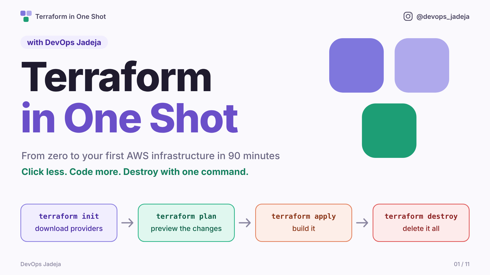

---

## 🎯 By the end of this session you can

- explain what Terraform is and why teams use it
- read and write a Terraform block
- run the loop: `init` → `plan` → `apply` → `destroy`
- use variables, `for_each`, locals and outputs
- build real AWS infrastructure: S3 buckets and a web server
- explain state, remote state, modules and separate environments

**No Terraform knowledge needed. We start from zero.**

---

## 📦 What is in this folder

```
terraform-class/
├── README.md        ← you are here
├── steps/           ← the finished code for every step (never edit these)
│   ├── 01-first-file/            ├── 07-three-buckets/
│   ├── 02-change-and-destroy/    ├── 08-versioned-and-private/
│   ├── 03-copy-paste-problem/    ├── 09-ec2-web-server/
│   ├── 04-variables-for-each/    ├── 10-remote-state/
│   ├── 05-locals-and-outputs/    ├── 11-modules/
│   └── 06-aws-one-bucket/        └── 12-environments/
├── work/            ← OUR folder. Everything we type goes here.
└── images/          ← the slides
```

### How to follow along

1. **Type in `work/`.** Open a terminal there and type exactly what you see on screen.
2. **Fell behind? No problem.** Copy the finished step into your folder and carry on:
   ```bash
   cp -r ../steps/04-variables-for-each/* .
   ```
3. Two files are **yours** and are never overwritten by later steps: `terraform.tfvars` (your name, from step 6) and `backend.tf` (your state bucket, from step 10). If you jump ahead, copy **step 6 first**, set your name in it, then copy the step you want. Step 12 builds its folders with a small script that takes your name and state bucket, so nothing is overwritten there either.

> 💡 Terraform reads **every `.tf` file in the folder**. File names are just for humans. We only split code into new files when a file gets crowded.

---

## 🗺️ Agenda

| Step | What we build | What you learn |
|---|---|---|
| 0 | Install Terraform, setup check | Why Terraform |
| 1 | One local file | `resource` block, `init` / `plan` / `apply` |
| 2 | Change it, break it, destroy it | Plan symbols, state, drift |
| 3 | Three files, copy-pasted | The problem |
| 4 | One block, many files | `variable`, `for_each` |
| 5 | Reuse a value, print a result | `locals`, `output` |
| 6 | An AWS S3 bucket | Provider, authentication |
| 7 | Three buckets: dev, stage, prod | `for_each` on real infrastructure |
| 8 | Versioned and private buckets | References between resources |
| 9 | A web server on EC2 | Data sources, dependencies |
| 10 | Share the state with a team | Remote backend, locking |
| 11 | A reusable recipe | Modules |
| 12 | Dev, stage and prod in separate folders | Environments, one state file each |
| 13 | Clean up and recap | `destroy`, the big picture |

---

## 🛠️ Setup: install Terraform (latest version)

Install the **latest** Terraform. At the time of writing that is **1.17.x**. Anything **1.10 or newer** works for this session.

**macOS** (Homebrew)
```bash
brew tap hashicorp/tap
brew install hashicorp/tap/terraform
```

**Windows** (PowerShell, pick one)
```powershell
winget install Hashicorp.Terraform
# or
choco install terraform
```

**Ubuntu / Debian**
```bash
sudo apt-get update && sudo apt-get install -y gnupg software-properties-common wget
wget -O- https://apt.releases.hashicorp.com/gpg | sudo gpg --dearmor -o /usr/share/keyrings/hashicorp-archive-keyring.gpg
echo "deb [signed-by=/usr/share/keyrings/hashicorp-archive-keyring.gpg] https://apt.releases.hashicorp.com $(lsb_release -cs) main" | sudo tee /etc/apt/sources.list.d/hashicorp.list
sudo apt-get update && sudo apt-get install -y terraform
```

**Amazon Linux / RHEL**
```bash
sudo yum install -y yum-utils
sudo yum-config-manager --add-repo https://rpm.releases.hashicorp.com/AmazonLinux/hashicorp.repo
sudo yum -y install terraform
```

**Any system:** download the binary from the official page, **developer.hashicorp.com/terraform/install**, unzip it, and put `terraform` on your `PATH`.

**Already have Terraform?** Upgrade it: `brew upgrade hashicorp/tap/terraform` (macOS), or `sudo apt-get update && sudo apt-get install --only-upgrade terraform` (Ubuntu/Debian).

## ✅ Setup check

```bash
terraform -version            # shows the version: 1.10 or newer
terraform -help               # prints the list of commands if the install worked
aws --version                 # AWS CLI, needed from step 6
aws sts get-caller-identity   # proves you are logged in to AWS
```
- Need the AWS CLI? Install it from **docs.aws.amazon.com/cli**, then run `aws configure`.
- Steps 1 to 5 need **no cloud account**. Everything happens on your laptop.
- Steps 6 to 12 use AWS. We build in **`ap-south-1`**.
- 🔐 **Credentials never go in `.tf` files.** Terraform reads the ones from `aws configure`.

### 📂 Get the folder ready

You don't need to create anything. Unzip the kit and work inside its `work/` folder. **Every command in this guide is run from `work/`.**
```bash
unzip terraform-class.zip
cd terraform-class/work
pwd        # should end with /terraform-class/work
```

---

# STEP 0 · Why Terraform?

> **The boss says:** *"Create 3 S3 buckets for dev, stage and prod. Turn on versioning and block public access on all of them. And do the same in our second AWS account tomorrow."*

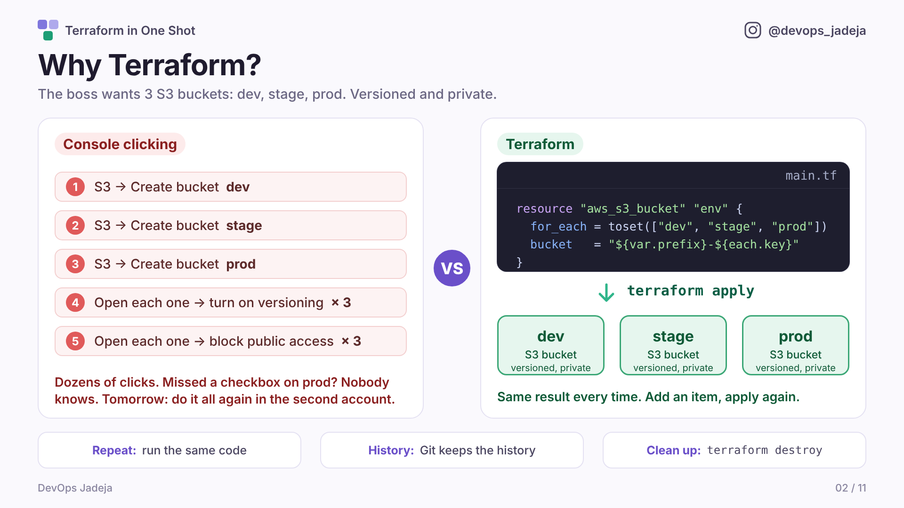

Clicking works once. It does not work **repeatedly**, **safely**, or **for a team**. Terraform lets us describe infrastructure in text files, so we can run, review, share and delete it like code.

---

# STEP 1 · Your first resource

**The question:** how do I tell the computer *what I want* instead of clicking?
**The idea:** a `resource` block, and the `init → plan → apply` loop.

Create **`main.tf`**:
```hcl
resource "local_file" "hello" {
  filename = "hello.txt"
  content  = "Hello from Terraform!\n"
}
```

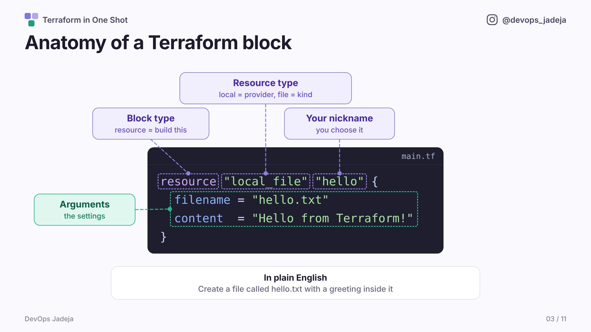

| Part | In our code | Meaning |
|---|---|---|
| Block type | `resource` | "I want this to exist" |
| Resource type | `local_file` | provider `local` + kind `file` |
| Nickname | `hello` | Your name for it. Referred to as `local_file.hello` |
| Arguments | `filename`, `content` | `name = value` settings inside `{ }` |

Now run the loop:
```bash
terraform init      # downloads the 'local' provider
terraform plan      # preview: nothing has changed yet
terraform apply     # type: yes
cat hello.txt
```
Notice the new files: `.terraform/`, `.terraform.lock.hcl` and `terraform.tfstate`.

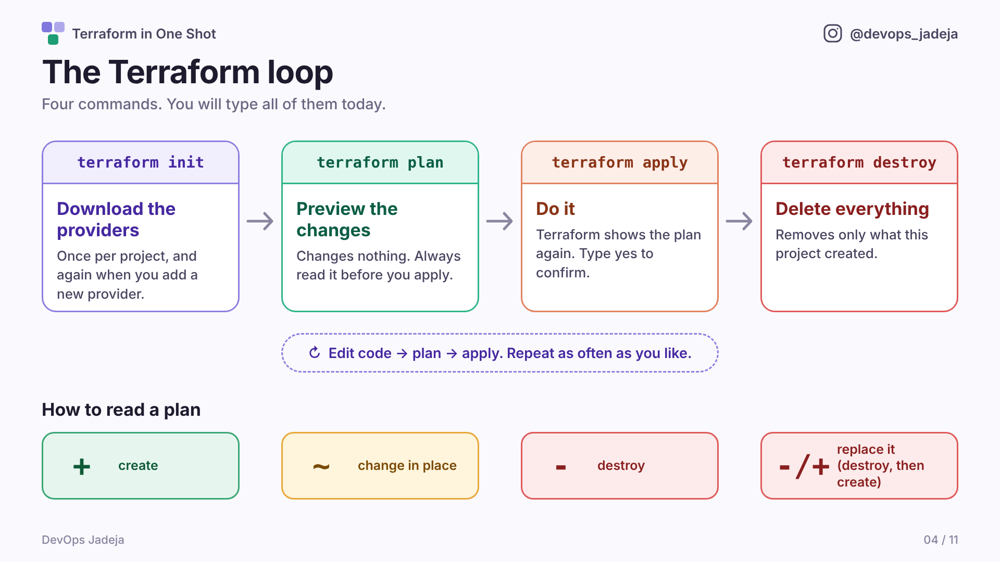

**🧪 Try it:** change `filename` to `<yourname>.txt` and `content` to your own message. Run `plan`, then `apply`. What does the plan say about the old file?

---

# STEP 2 · Change it, break it, destroy it

**The question:** what if I change my mind? What if someone deletes the file by hand?
**The idea:** plan symbols, the **state** file, **drift**.

**Change the code.** Edit `content` in `main.tf`:
```hcl
resource "local_file" "hello" {
  filename = "hello.txt"
  content  = "Hello from Terraform, version 2!\n"
}
```
```bash
terraform plan
```
The plan says `-/+ must be replaced`: a file's content can't be edited in place, so Terraform deletes and re-creates it. Plan symbols:

| Symbol | Meaning |
|---|---|
| `+` | create |
| `~` | change in place |
| `-` | destroy |
| `-/+` | destroy and create again (replace) |

**Now delete the file behind Terraform's back:**
```bash
terraform apply          # yes
rm hello.txt
terraform plan           # "Objects have changed outside of Terraform"  →  Plan: 1 to add
terraform apply          # the file is back
```
This is **drift**: reality no longer matches the code.

**Look at Terraform's notebook (the state):**
```bash
terraform state list
terraform show
```

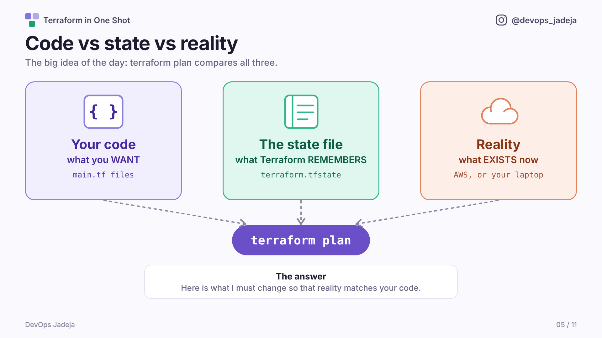

`terraform plan` compares **your code**, **the state** (what Terraform remembers) and **reality** (what exists).

**Clean up:**
```bash
terraform destroy        # yes
```

---

# STEP 3 · The copy-paste problem

**The question:** now we need **one file per student**.

Replace `main.tf` with three resources (`steps/03-copy-paste-problem/main.tf`):
```hcl
resource "local_file" "alice" {
  filename = "alice.txt"
  content  = "Hello, alice!\n"
}

resource "local_file" "bob" {
  filename = "bob.txt"
  content  = "Hello, bob!\n"
}

resource "local_file" "carol" {
  filename = "carol.txt"
  content  = "Hello, carol!\n"
}
```
```bash
terraform apply
```
It works. But think: **30 students? A new student next week? Renaming every block by hand?** There must be a better way. 👇

---

# STEP 4 · Variables and for_each

**The idea:** a `variable` is a value that comes **in**. `for_each` makes **one resource per item**.

Create **`variables.tf`**:
```hcl
variable "students" {
  description = "One file is created for each name in this list"
  type        = list(string)
  default     = ["alice", "bob", "carol"]
}
```
Replace **`main.tf`**:
```hcl
resource "local_file" "student" {
  for_each = toset(var.students)
  filename = "${each.key}.txt"
  content  = "Hello, ${each.key}!\n"
}
```
```bash
terraform plan
```
👀 **Notice:** the plan says **3 to add, 3 to destroy**. Why? The *address* changed from `local_file.alice` to `local_file.student["alice"]`. Terraform tracks things by address, so the nickname **is** the identity. (Advanced sessions cover `moved` blocks, which rename without destroying.)
```bash
terraform apply
```
**Now the payoff:** add `"dave"` to the list in `variables.tf`, then:
```bash
terraform plan           # Plan: 1 to add. The other three are untouched.
terraform apply
```

| Piece | Meaning |
|---|---|
| `var.students` | reads the variable |
| `toset(...)` | turns the list into a set (a list without duplicates) |
| `each.key` | the current item |

---

# STEP 5 · Locals and outputs

**The question:** the word "Hello" is repeated, and we never see a summary of what was created.
**The idea:** `locals` are values calculated inside and reused. `output` prints a value.

Edit **`main.tf`**:
```hcl
locals {
  greeting = "Hello"
}

resource "local_file" "student" {
  for_each = toset(var.students)
  filename = "${each.key}.txt"
  content  = "${local.greeting}, ${each.key}!\n"
}
```
Create **`outputs.tf`**:
```hcl
output "files_created" {
  description = "Names of the students who got a file"
  value       = keys(local_file.student)
}
```
```bash
terraform apply          # prints: files_created = ["alice", "bob", "carol", "dave"]
```
**Power move:** change `greeting` to `"Namaste"` and run `terraform plan`. Every file changes from **one edit**.

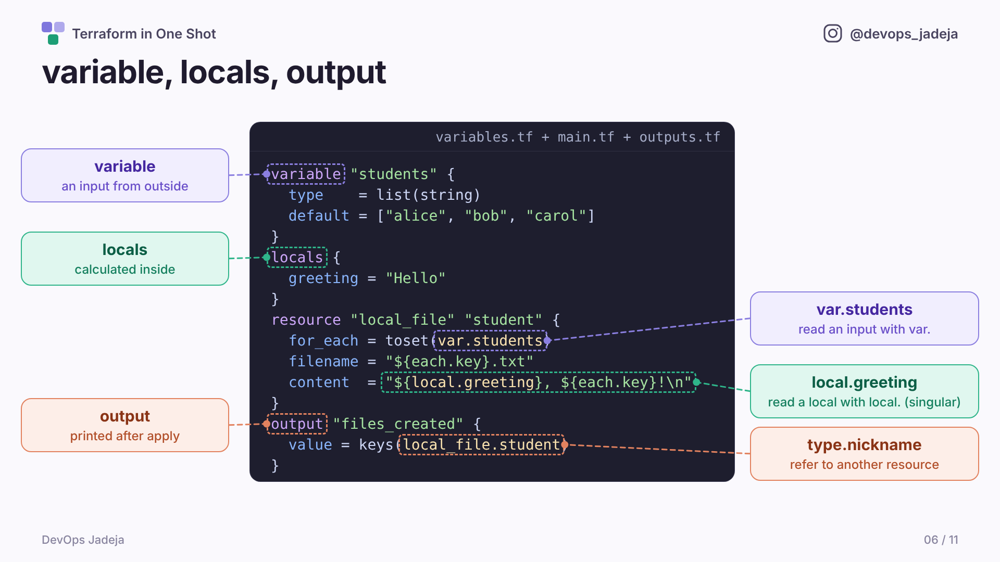

| Block | Like a function's... | Read it with |
|---|---|---|
| `variable` | parameter | `var.name` |
| `locals` | local variable | `local.name` (singular!) |
| `output` | return value | printed after `apply` |

> ⚠️ The block is `locals` (plural), but you read it as `local.x` (singular).

```bash
terraform destroy        # yes
```

🎉 **That is most of Terraform's syntax.** From here, it is the same shapes with a different provider.

---

# 🧹 Moving from local files to AWS

Start from a clean folder. Run this inside `work/`:
```bash
terraform destroy -auto-approve
rm -rf * .terraform .terraform.lock.hcl terraform.tfstate*
```

---

# STEP 6 · An AWS bucket

**The question:** files on a laptop are not infrastructure. How do we talk to AWS?
**The idea:** the **AWS provider**, authentication, and a `.tfvars` file.

```bash
cp -r ../steps/06-aws-one-bucket/* .
```
Open **`terraform.tfvars`** and **set `prefix` to your own lowercase name**. S3 bucket names are unique across all of AWS.

| File | What it holds |
|---|---|
| `providers.tf` | Which provider and version (`~> 6.0`), which region |
| `variables.tf` | `region` (has a default) and `prefix` (no default, so we must supply it) |
| `terraform.tfvars` | The actual value for `prefix` |
| `main.tf` | One `aws_s3_bucket` |
| `outputs.tf` | Prints the bucket name |

> Terraform knows nothing about AWS on its own. The **provider** does. Terraform is the brain; providers are the hands. It logs in with the credentials from `aws configure`, never from our code.

```bash
terraform init       # downloads the AWS provider (about 30 seconds)
terraform plan
terraform apply
```
Open **AWS Console → S3** and find your bucket.

---

# STEP 7 · Three buckets

**The question:** we need dev, stage and prod. All the same.
**The idea:** nothing new! It is the same `for_each` as step 4, on a real AWS resource.

```bash
cp -r ../steps/07-three-buckets/* .
terraform plan
```
Notice: the old `demo` bucket is destroyed and three `env` buckets are created. New nickname, new address.

What changed in the code:
- `variables.tf` gained `environments` (`dev`, `stage`, `prod`)
- `main.tf` now uses `for_each`, plus a `locals` block for tags, and `merge()` to combine two tag maps

```bash
terraform apply
```

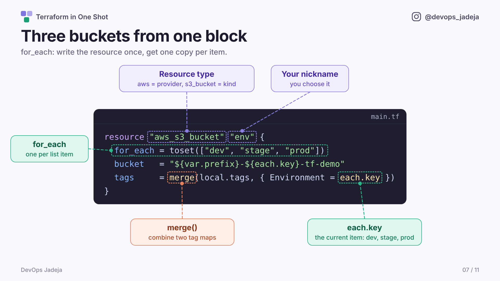

**🧪 Try it:** add `"qa"` to `environments` in `variables.tf` and `apply`. One new bucket, three untouched.

---

# STEP 8 · Versioned and private

**The question:** these buckets exist, but nothing protects them.
**The idea:** resources that **point at other resources**, and **nested blocks**.

```bash
cp -r ../steps/08-versioned-and-private/* .
terraform plan        # Plan: 6 to add
terraform apply
```
Two new resources in `main.tf`:
- `for_each = aws_s3_bucket.env` loops over the buckets we already made.
- `bucket = each.value.id` is *each* bucket's ID. Because of this reference, Terraform knows to build the bucket first. **We never wrote an order.**
- `versioning_configuration { ... }` is a **nested block** inside a resource.

Check in the console: bucket → **Properties** (versioning *Enabled*) and **Permissions** (*Block all public access: On*).

---

# STEP 9 · A web server on EC2

**The question:** we need a server. Which image ID do we use? It is different in every region.
**The idea:** a **data source** reads something that already exists. And dependencies.

> Small cost: we destroy it in the next step.

```bash
cp -r ../steps/09-ec2-web-server/* .
```
This **adds a new file, `ec2.tf`**. We didn't touch `main.tf`: Terraform reads every `.tf` file in the folder.

| Block | Plain English |
|---|---|
| `data "aws_ami" "al2023"` | **Look up** the newest Amazon Linux image (`data` reads, never creates) |
| `aws_security_group.web` | Firewall: allow web traffic on port 80 |
| `aws_instance.web` | The server. It uses `data.aws_ami.al2023.id` and `aws_security_group.web.id` |

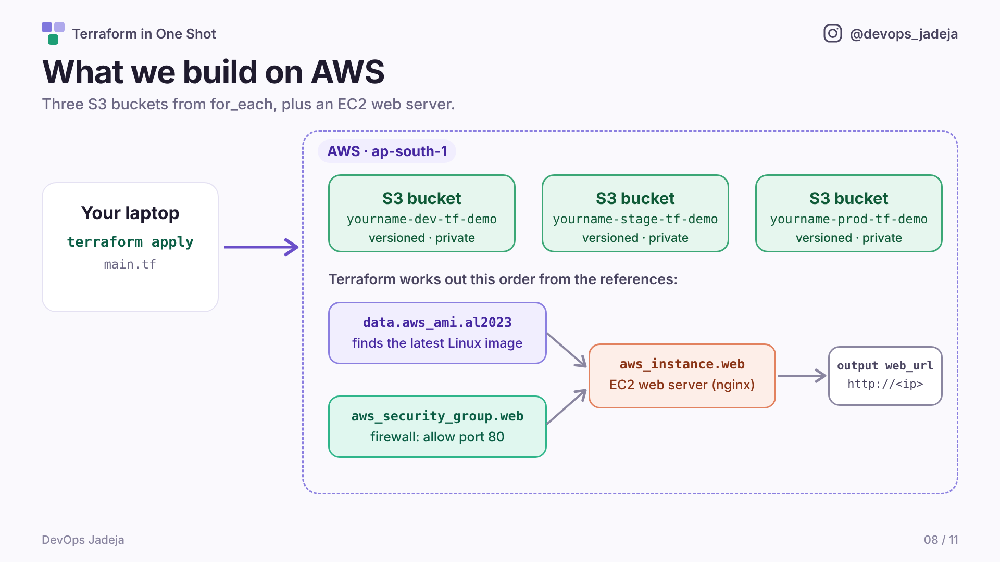

```bash
terraform apply       # about 1 to 2 minutes
```
`outputs.tf` prints `web_url`. Wait about a minute for nginx to start, then open the URL in your browser. 🎉

---

# STEP 10 · Remote state

**The question:** my teammate needs to run this too. Where is Terraform's notebook?
**The idea:** a **backend** stores state somewhere shared, with **locking**.

**First, remove the server.** Delete the code and Terraform deletes the infrastructure:
```bash
rm ec2.tf
cp ../steps/10-remote-state/outputs.tf .      # outputs.tf must stop mentioning the server
terraform apply                              # destroys the EC2 instance and the security group
```
**Where is the state right now?**
```bash
ls -la terraform.tfstate
head -20 terraform.tfstate
```
It is a file on **my laptop**. A teammate has a different one, and they disagree about what exists. It can also contain secrets, so it never goes in Git.

**Create a shared place for it** (once, outside Terraform). Use your own name:
```bash
aws s3api create-bucket --bucket yourname-terraform-state \
  --region ap-south-1 --create-bucket-configuration LocationConstraint=ap-south-1
```
**Add the backend**, then edit the bucket name inside it:
```bash
cp ../steps/10-remote-state/backend.tf .
terraform init -migrate-state      # answer: yes
aws s3 ls s3://yourname-terraform-state/dev/
```

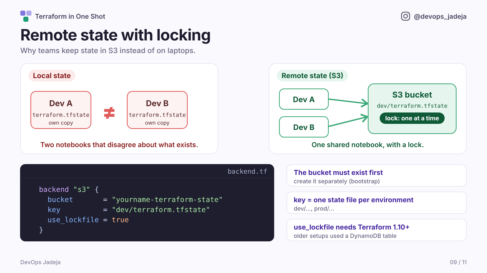

| Setting | Meaning |
|---|---|
| `key` | One state file per environment (`dev/...`, later `prod/...`) |
| `use_lockfile = true` | Terraform writes a lock during `apply`, so two people can't run at once (Terraform 1.10+) |
| (no variables) | A backend block **cannot use variables**, so values are typed in |

> **Why no DynamoDB table?** Before Terraform 1.10, locking an S3 backend needed a separate DynamoDB table (`dynamodb_table = "..."`, with a key called `LockID`). You will still see it in older projects. Newer Terraform locks inside S3 itself with `use_lockfile = true`, so there is nothing extra to create, and the DynamoDB option is now deprecated. Both do the same job: **one `apply` at a time**.

---

# STEP 11 · Modules

**The question:** another team wants the exact same secure bucket: bucket + versioning + private. Copy all three resources again? And again for the next team?
**The idea:** a **module** is a folder of `.tf` files with **inputs** and **outputs**, called like a function.

```bash
cp -r ../steps/11-modules/* .      # adds modules.tf and the modules/ folder; your backend.tf stays
terraform init        # "Initializing modules..." Modules need an init too.
terraform plan        # Plan: 6 to add (2 buckets x 3 resources)
terraform apply
```

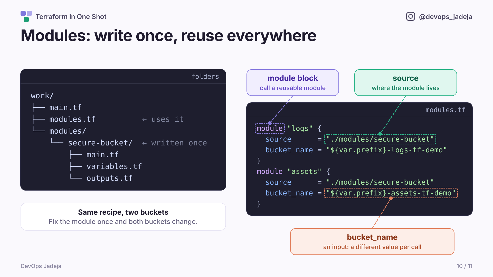

- `modules/secure-bucket/` is **written once**. It takes one input, `bucket_name`, and builds the three resources.
- `modules.tf` calls it twice with different names. **Same recipe, two buckets.**
- Resource addresses now read `module.logs.aws_s3_bucket.this`. Fix the module once and every bucket made from it changes.

> One module, many uses. Next we use it the way real teams do: **one folder per environment**.

**🧪 Try it:** add a third call named `backups` in `modules.tf` and `apply`.

---

# STEP 12 · Dev, stage and prod in separate folders

**The question:** so far one `apply` touches everything, and all our buckets share **one** state file. A mistake while working on dev could hit prod. How do real teams keep environments apart?
**The idea:** **one folder per environment**, each with its **own state file**, all calling the **same module**.

**First, remove the project from steps 7 to 11.** Its state is in S3, and we **keep the state bucket** because we reuse it:
```bash
terraform destroy                                  # read the plan, then: yes
rm -rf .terraform .terraform.lock.hcl *.tf         # removes the old root code; modules/ stays
```
The destroy plan lists 15 resources: three env buckets with their versioning and public-access blocks, plus the two module buckets with theirs.

**Create the three environment folders.** Use your own `prefix` and state bucket name:
```bash
PREFIX=jadeja STATE_BUCKET=jadeja-terraform-state \
  bash ../steps/12-environments/create-environments.sh
```
The script writes the files for you, so nobody types them three times. (`dev` reuses the `dev/terraform.tfstate` key from step 10. That state is empty after the destroy, so nothing clashes.) Look at the result:
```bash
ls environments
cat environments/dev/main.tf
cat environments/dev/backend.tf
```

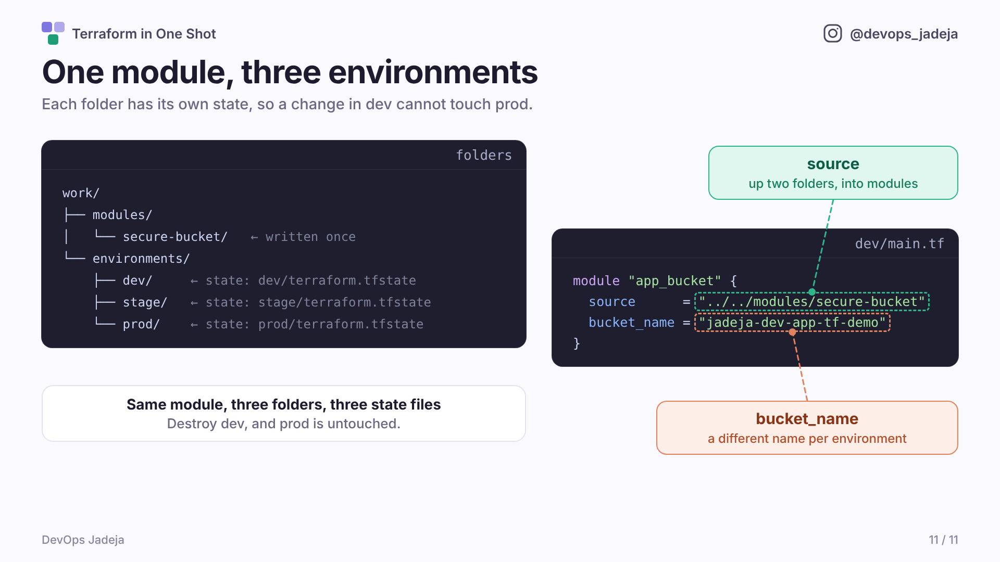

Every folder has the same six files. Only two lines differ between environments:

| File | What it holds | Differs per environment? |
|---|---|---|
| `providers.tf` | AWS provider and version | no |
| `variables.tf` | `region`, `prefix` | no |
| `terraform.tfvars` | your `prefix` | no |
| `backend.tf` | where the state lives | **yes**: `key = "dev/..."`, `"stage/..."`, `"prod/..."` |
| `main.tf` | calls the module | **yes**: the bucket name contains `dev`, `stage` or `prod` |
| `outputs.tf` | prints the bucket name | no |

In `main.tf`, `source = "../../modules/secure-bucket"` means *go up two folders (out of `dev` and `environments`), then into `modules`*. All three folders use the **same recipe**.

**Run each environment on its own:**
```bash
cd environments/dev
terraform init
terraform apply          # yes: 3 resources (bucket, versioning, public-access block)

cd ../stage
terraform init
terraform apply

cd ../prod
terraform init
terraform apply

cd ../..
```
**Prove the states are separate:**
```bash
aws s3 ls s3://jadeja-terraform-state/ --recursive
```
You should see three state files: `dev/terraform.tfstate`, `stage/terraform.tfstate` and `prod/terraform.tfstate`. Inside any environment folder, `terraform state list` shows **only that environment's** resources.

**The payoff: destroy only dev.**
```bash
cd environments/dev
terraform destroy        # yes: only dev's 3 resources
cd ../stage
terraform plan           # "No changes". Stage did not notice.
cd ../..
```

| | One folder + `for_each` (steps 7 and 8) | One folder per environment |
|---|---|---|
| State files | One for everything | One per environment |
| `apply` touches | All environments together | Only that environment |
| A mistake in dev can hit prod | Yes | No |

> **The trade-off:** a few small files (`providers.tf`, `variables.tf`, `backend.tf`) repeat in each folder. That is normal, and it is the price of keeping environments apart. Larger teams later use pipelines or tools like Terragrunt to cut the repetition.

**🧪 Try it:** in `environments/prod/main.tf`, add a second module call for a `backups` bucket and `apply` **only in `prod`**. Check that dev and stage show no changes.

---

# STEP 13 · Clean up and recap

```bash
for env in dev stage prod; do
  (cd environments/$env && terraform destroy -auto-approve)
done
aws s3 rb s3://jadeja-terraform-state --force     # remove the state bucket (we made it outside Terraform)
```
Dev may already be gone, which is fine. Check the S3 console is empty. 🎉

### 🧠 Where each idea came from

| Idea | Why we needed it |
|---|---|
| `resource` | to say what we want |
| `plan` / `apply` / `destroy` | to preview, build and remove |
| state | so Terraform remembers what it built |
| `variable` + `for_each` | to stop copy-pasting |
| `locals` + `output` | to reuse a value and print results |
| provider | to talk to AWS |
| references | so Terraform works out the build order itself |
| `data` | to read what already exists |
| remote backend | so a team shares one notebook, with a lock |
| `module` | to reuse a whole recipe |
| folder per environment | to keep dev, stage and prod apart, each with its own state |

### ✅ Check yourself
1. What do `plan` and `apply` do differently?
2. What is the state file, and why does it matter?
3. Why did Terraform destroy and re-create when we renamed a resource?
4. When do you reach for `for_each`? For a module?
5. Why does a team need a remote backend?
6. Why give each environment its own folder and its own state file?

### 🗺️ What comes next

| Session | Topic |
|---|---|
| 2 | S3 deep dive: encryption, lifecycle rules, `count` vs `for_each` |
| 3 | VPC networking, then EC2 inside it |
| 4 | State in depth: `state mv/rm`, `moved`, `import` |
| 5 | Environments in depth: per-environment `tfvars`, promoting dev → prod, workspaces |
| 6 | CI/CD with GitHub Actions: plan on pull request, apply on merge |

---

# 📋 Cheat sheet

| Command | What it does |
|---|---|
| `terraform init` | Download providers and modules; set up the backend |
| `terraform fmt` | Tidy formatting |
| `terraform validate` | Check syntax |
| `terraform plan` | Preview changes |
| `terraform apply` | Make the changes |
| `terraform destroy` | Delete everything this project made |
| `terraform output` | Show the outputs again |
| `terraform state list` | List what Terraform tracks |
| `terraform init -migrate-state` | Move local state into a new backend |

### 🗂️ Which file holds what (the final project)

| File | Holds |
|---|---|
| `providers.tf` | Terraform version, providers, region |
| `variables.tf` | Inputs (`variable` blocks) |
| `terraform.tfvars` | Values for those inputs |
| `main.tf` | Your resources and locals |
| `ec2.tf` | The web server (its own file, because it is its own topic) |
| `modules.tf` | Calls to modules |
| `outputs.tf` | Values printed after apply |
| `backend.tf` | Where state is stored |
| `modules/secure-bucket/` | A reusable recipe |
| `environments/dev`, `stage`, `prod` | One folder per environment, each with its own `backend.tf` key |

### 🚨 Errors you might see

| Error | Meaning | Fix |
|---|---|---|
| `BucketAlreadyExists` | Someone in the world has that name | Change `prefix` in `terraform.tfvars` |
| `No valid credential sources found` | Terraform can't log in to AWS | Run `aws configure`; check `aws sts get-caller-identity` |
| `Backend initialization required` | Backend or modules changed | Run `terraform init` |
| `Error acquiring the state lock` | Another run holds the lock, or one crashed | Wait; if it crashed, `terraform force-unlock <ID>` |
| `No default VPC` (step 9) | The account has no default VPC | `aws ec2 create-default-vpc` |
| `Unsupported argument` | Typo in an argument name | Compare with the code in `steps/` |

### 🏠 Homework
1. Add a fourth environment (`qa`) and apply. How many resources change?
2. Add a tag `Owner = "<your name>"` in `local.tags`. Read the plan before applying.
3. In `environments/prod/main.tf`, add a third module call, then `apply` in `prod` only. Change the module so buckets also get a lifecycle rule. What happens to dev, stage and prod?
4. Destroy everything and confirm your S3 console is empty.

---

**Thank you! 🙌** Follow **@devops_jadeja** on Instagram for more DevOps.
# Terraform-zidd3.0
